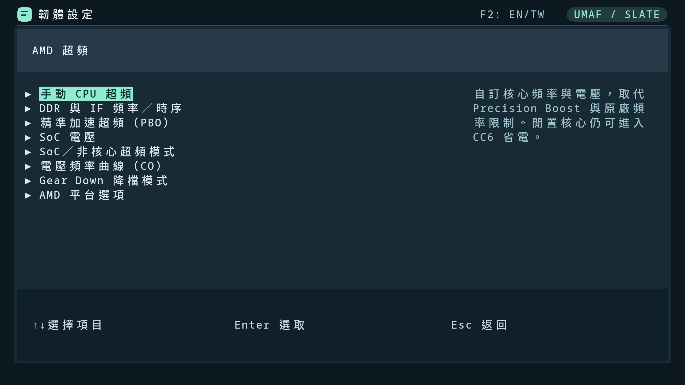
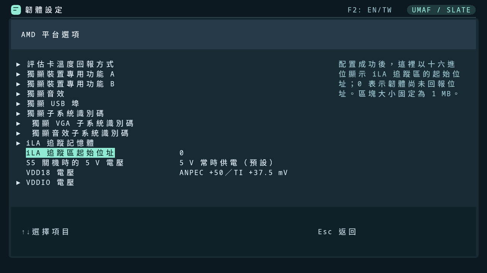
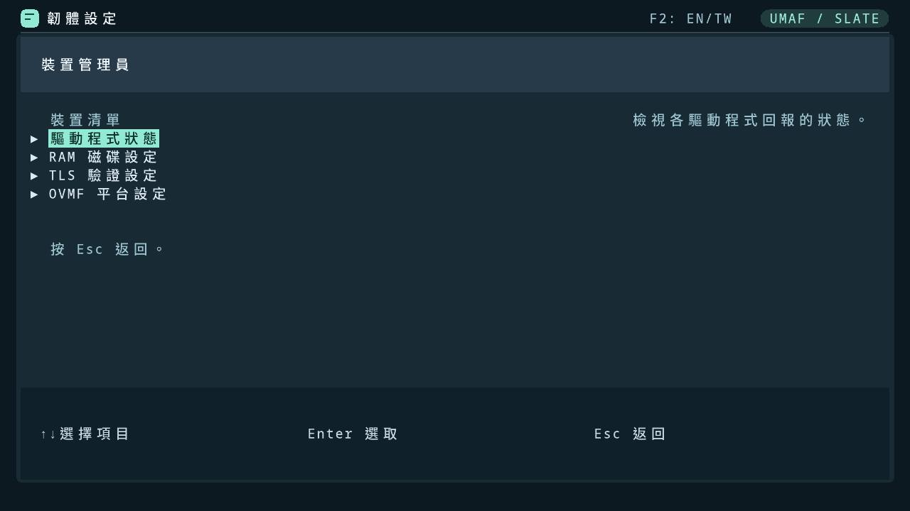
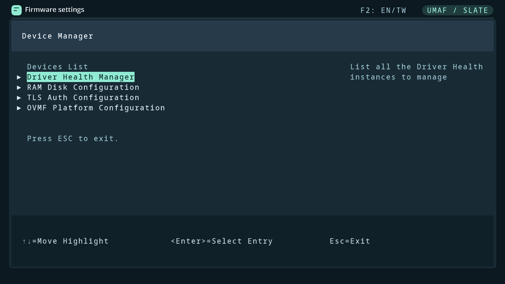

# UMAF Slate 繁體中文版

用繁體中文瀏覽 AMD 韌體選單。選取項目後，右側會顯示說明；想對照英文原文，按 **F2** 就能切換。

## 用隨身碟啟動

1. [下載 USB 版（v1.2.2）](https://github.com/AngelSherry/UMAF-Slate-zh-TW/releases/download/v1.2.2/UMAF-Slate-1.2.2-zh-TW-FAT32-USB.zip)。
2. 將壓縮檔解壓縮到空白的 FAT32 隨身碟，確認打開隨身碟就能看到 `EFI` 和 `SL` 兩個資料夾。
3. 重新開機，從開機選單選擇隨身碟，再進入「裝置管理員」查看設定。

調整設定前，建議先記下原值。

## 介面預覽

<table>
  <tr>
    <th width="50%">AMD 超頻選單</th>
    <th width="50%">AMD 平台選項</th>
  </tr>
  <tr>
    <td></td>
    <td></td>
  </tr>
  <tr>
    <th width="50%">裝置管理員（中文）</th>
    <th width="50%">裝置管理員（英文）</th>
  </tr>
  <tr>
    <td></td>
    <td></td>
  </tr>
</table>

原版工具：[Smokeless_UMAF](https://github.com/DavidS95/Smokeless_UMAF)。
